# CodeOps

CodeOps turns product goals into engineering tasks and isolated AI coding runs,
with human approval, inspectable evidence and explicit delivery.

[Live interactive showcase](https://codeops-showcase.tahabd.workers.dev) ·
[User guide](docs/user-guide.md) · [Quick start](#quick-start-windows) ·
[Architecture](docs/architecture.md)

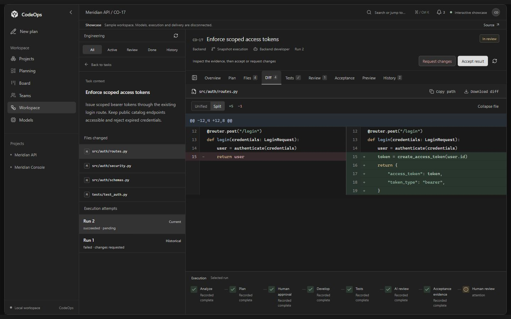

**Explore the interface:** [New plan](#new-plan) · [Projects](#projects) ·
[Planning](#planning) · [Board](#board) · [Teams](#teams) ·
[Workspace](#workspace) · [Models](#models)

All images below are actual captures of the current application with labeled
sample records. The public showcase lets you explore the frontend and selected
sample edits; it does not call models, run containers, connect repositories or
deliver code. Models is read-only there. The full local application provides those
capabilities with its API, workers and configured providers.

## From a goal to reviewed code

```text
Project → Product goal → Editable draft → Human product-plan approval
→ Board / Teams → Assignment → Explicit execution
→ Repository analysis → Coding plan → Human coding-plan approval
→ Development → Tests / bounded repair → AI review → Acceptance evidence
→ Optional preview → Human accept or Request Changes → Explicit delivery
```

Product-plan approval, coding-plan approval and human acceptance are separate
decisions. Assignment does not start an execution, and accepting a result does
not deliver it. Estimates describe rough effort, not guaranteed delivery time.

## Visual tour

### New plan

**New plan** in the sidebar opens Planning for the selected project. Describe the
outcome you want, then choose **Plan with CodeOps** to request a product draft.
The goal stays beside the proposed work so you can compare the request with the
plan. Submitting another goal creates another saved plan; earlier work is retained.

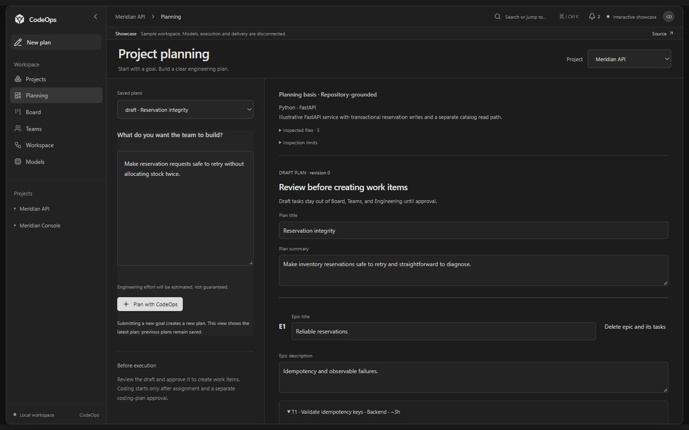

### Projects

Register an existing local repository, inspect its description, technology stack
and path, and open its planning context. The right pane provides shortcuts for the
current project. **Preview configuration** describes how that project's reviewed
application should start in an isolated preview environment.

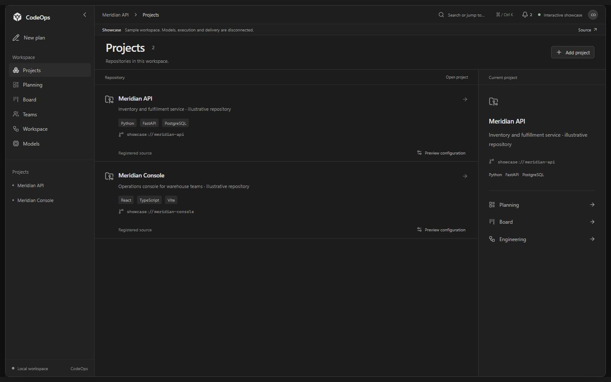

### Planning

Review and edit the draft's epics, task descriptions, priorities, effort estimates,
dependencies and acceptance criteria. The planning basis explains which repository
observations informed the proposal and where inspection was limited. Save edits,
then choose **Approve Plan & Create Work Items** when the breakdown is ready.
Draft `T` references become permanent `CO` task keys only after approval; drafts
stay out of Board, Teams and Engineering until then.

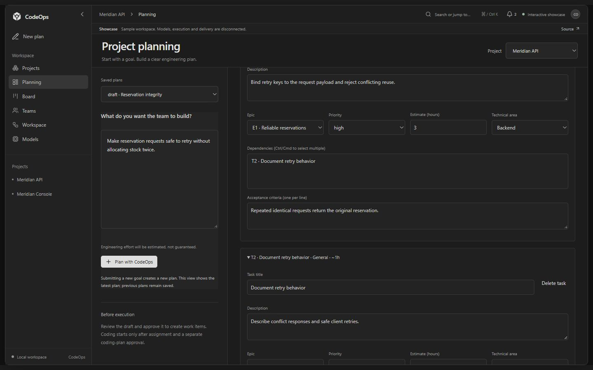

### Board

Track approved work through **Backlog**, **Planned**, **In progress**, **Review**
and **Done**. Cards show the task key, estimate, priority, technical area, owner
and dependencies. Filter by project, text, priority, area, assignee or squad, and
open a card to inspect its requirements and assignment. Tasks linked to an
execution follow that execution's lifecycle and human acceptance.

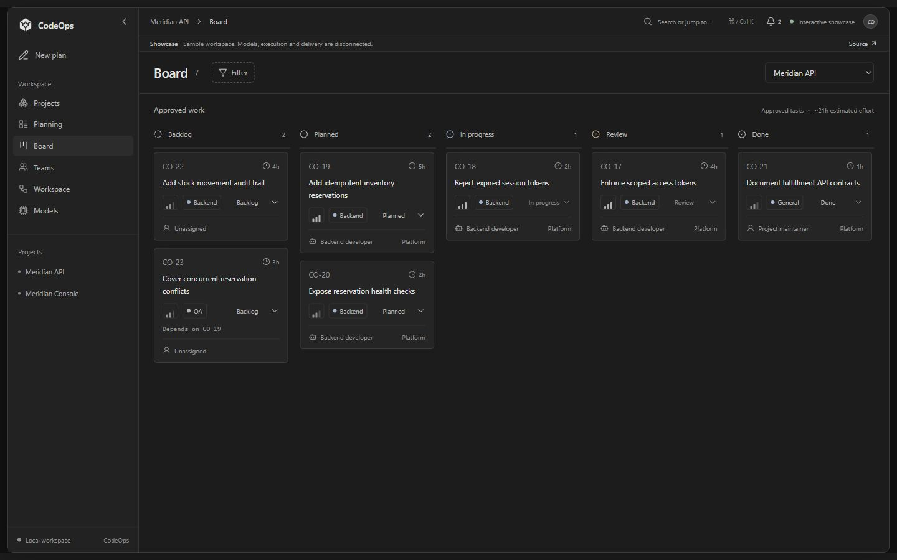

### Teams

Manage shared human and AI members, project memberships and squads. Human capacity
summarizes planned effort across projects. AI queued ownership and actual reserved
execution slots are displayed separately, including coding-plan approval waits.
Assign work yourself or review assignment suggestions before applying them;
assignment alone does not run agents.

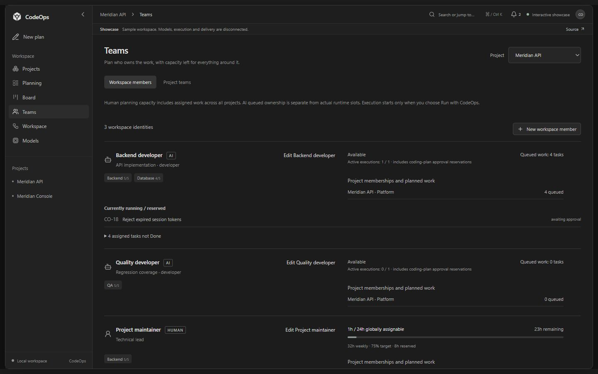

### Workspace

**Workspace** opens Engineering. Find a task using the All, Active, Review, Done
or History filters, then inspect its context and retained runs. Eligible assigned
work can be explicitly started. The task header presents the actions appropriate
to the selected state; the bottom strip navigates recorded execution stages.
**Overview** brings the request, changes, validation and next decision together.

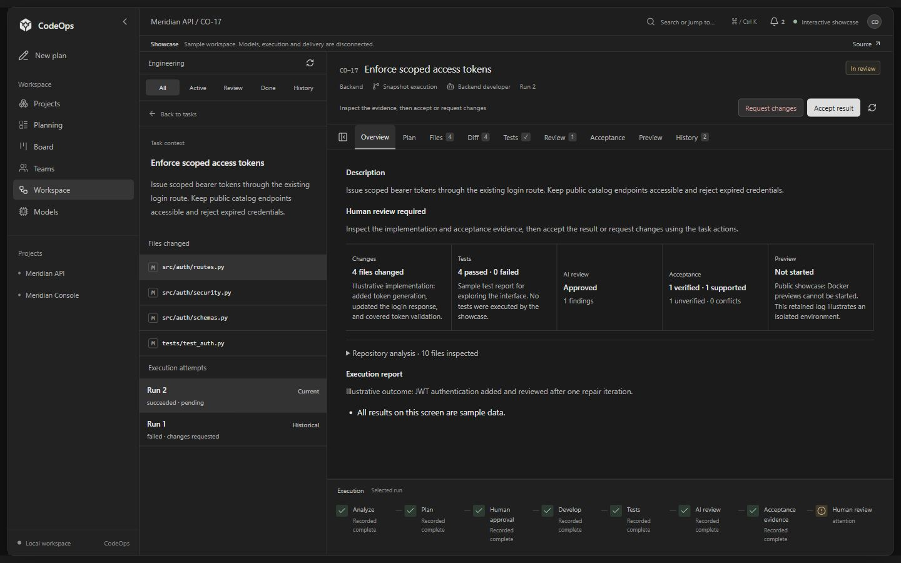

<details>
<summary><strong>Explore all nine Engineering tabs</strong></summary>

#### Overview

Read the task description, readiness or blockers, and summaries of changes, tests,
AI review and acceptance evidence. Before execution, inspect assignment and
dependency readiness. After execution, use the summaries to open retained artifacts.


#### Plan

Inspect the proposed implementation steps, affected files, planned validation,
risks and limitations. A waiting run requires a separate human coding-plan approval.
Choose the test runner, framework and bounded attempt limit before authorizing
continuation. Plan steps describe intended work, not verified completion.

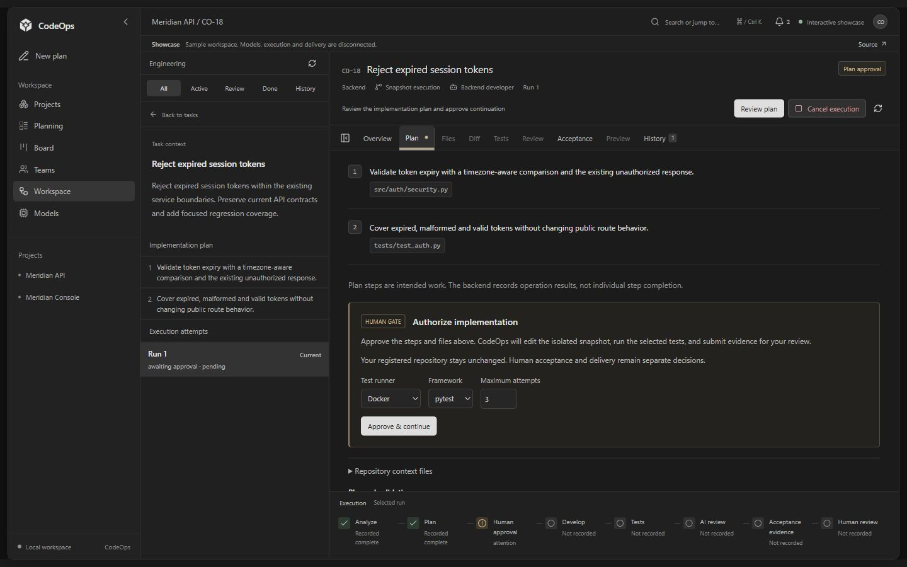

#### Files

Read the selected run's retained snapshot source with syntax highlighting and line
numbers. Select a changed file in the context pane or switch to its diff. This
view inspects saved source; it does not edit the original repository.

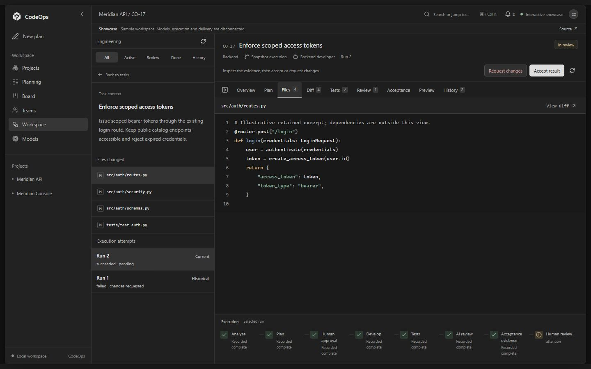

#### Diff

Compare added and removed lines using unified or split views. The changed-file
navigator, line numbers, hunk headers and change counts keep review focused.
Copy a path or download the retained diff for closer inspection.


#### Tests

Inspect the retained runner, command, duration, outcome, counts when reported,
and output logs. Failures remain evidence for inspection and repair. The report
shown here is explicitly illustrative showcase data, not a test executed by the
public site.

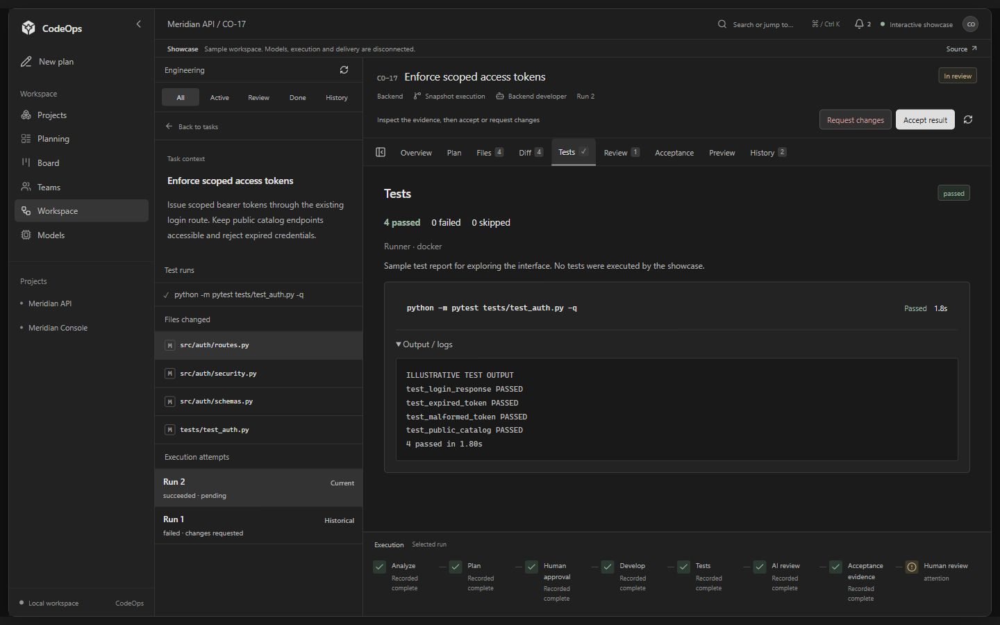

#### Review

Read the AI review summary and findings, including severity, source references,
evidence and recommended fixes when supplied. Open referenced source or diffs to
check the finding yourself. AI approval supplies evidence; it does not replace
human acceptance.

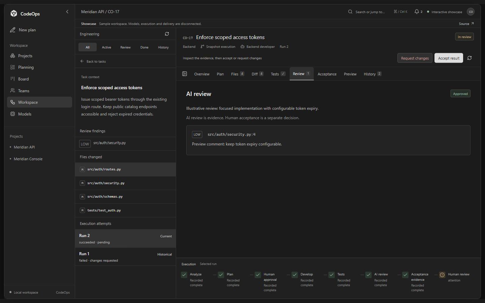

#### Acceptance

Compare each requirement with its retained evidence. CodeOps distinguishes
**verified**, **supported**, **unverified** and conflicting evidence, and links
back to source artifacts. An implementation association alone does not become a
passing test. Unresolved criteria require explicit acknowledgment before acceptance.

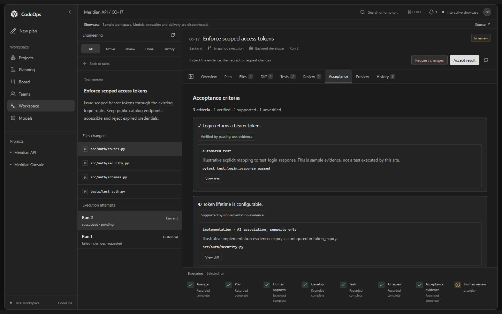

#### Preview

Inspect a temporary environment for human verification of an eligible successful
implementation. In the local runtime, preview uses isolated reviewed source,
health checks, a loopback URL, a lifetime limit and cleanup. Opening a preview does
not verify criteria or accept the task. The public showcase cannot start Docker;
its screen demonstrates the controls and retained preview information.

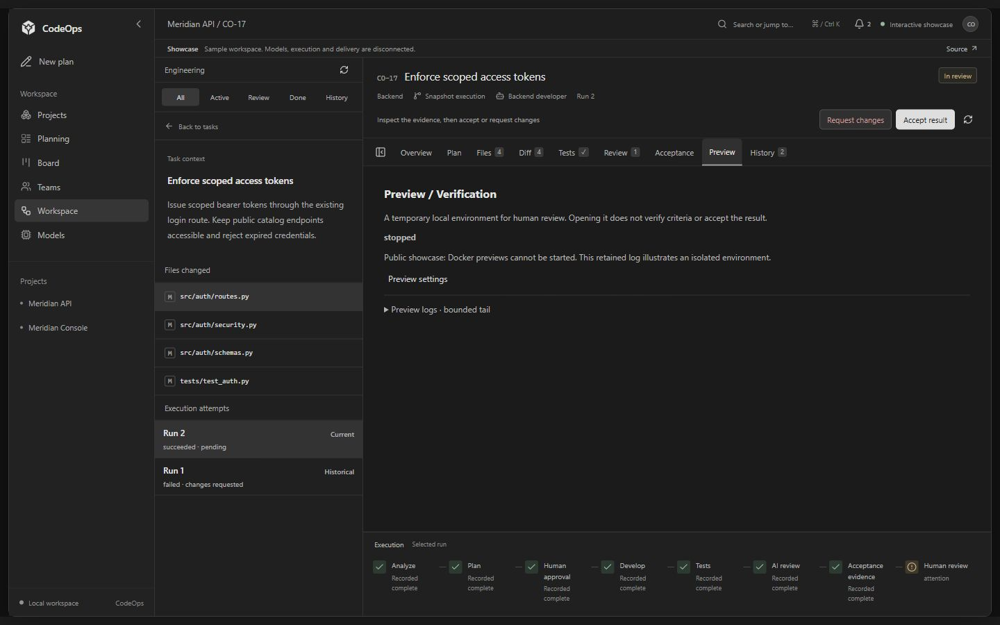

#### History

Inspect prior runs, operation timelines, repair attempts, failures and retained
feedback. Historical inspection remains read-only and uses the selected run's own
artifacts and decisions. Return to the current run to perform its available actions.

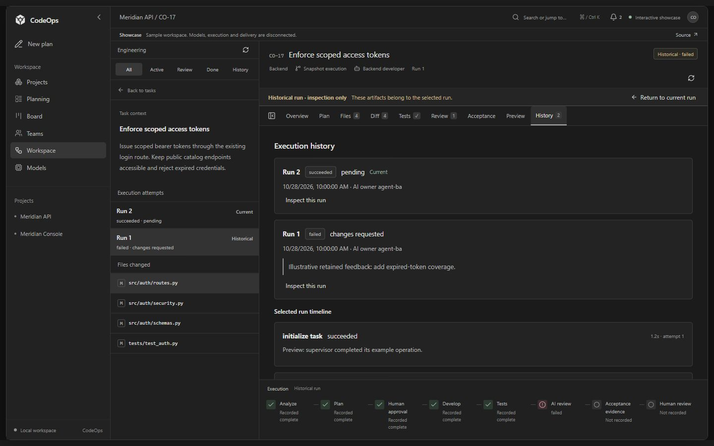

</details>

#### Human review and delivery

Use **Request changes** to record feedback and create a fresh run through the
existing workflow, or **Accept result** after reviewing the evidence. Acceptance
marks the EngineeringTask Done and stops any active preview for that run. Export,
local application and draft GitHub PR publication remain separate explicit actions;
GitHub delivery also requires the appropriate repository configuration and credentials.

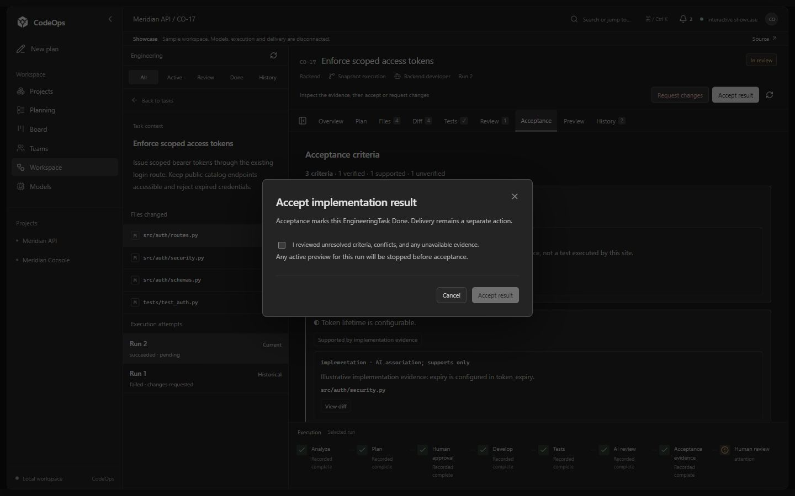

### Models

Connect NVIDIA NIM, Ollama, OpenAI-compatible, Anthropic, Gemini or a custom service
using a supported protocol. In the local app, add a provider, load or enter a model
ID, test it, and apply primary and optional fallback routing. Saved API keys stay
encrypted on the backend. Environment-based `ASE_*` configuration remains supported.

**Models is read-only in the public showcase:** provider edits, API-key storage, connection
tests and routing changes are disabled. A visible notice explains how to use these
controls in the local application. See [provider settings](docs/provider-settings.md)
and [fallback policy](docs/model-gateway.md) for configuration details.

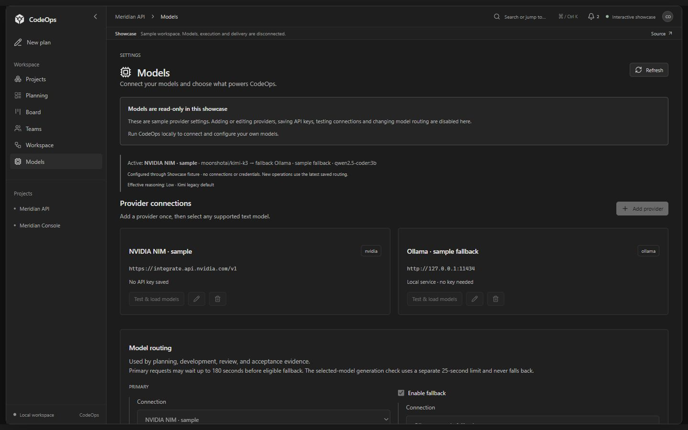

<details>
<summary>See primary and fallback model routing</summary>

Primary and fallback selections are separate. Fallback is used only for eligible
connection, timeout, rate-limit and availability failures; invalid results and
rejected reviews do not switch providers.

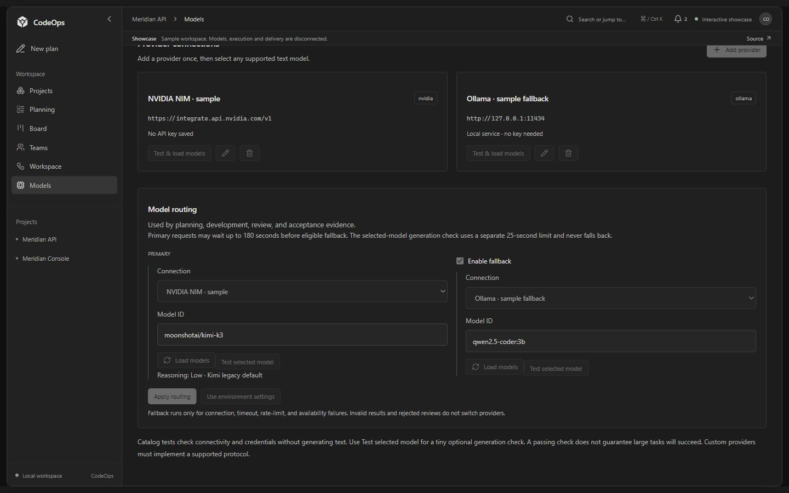

</details>

For a button-by-button walkthrough, use the [complete user guide](docs/user-guide.md).
The interface also includes Ctrl/Cmd+K command search, retained execution events,
keyboard-accessible tabs and dialogs, and reduced-motion support. See the
[design system](docs/design-system.md) and [capture notes](docs/screenshots/README.md).

## Architecture and human control

React/TypeScript → FastAPI/Pydantic → SQLAlchemy → durable LangGraph workers
→ model gateway → isolated source → tests/review → human decision.
SQLite is the default; PostgreSQL is optional. Independent workers perform
analysis, coding, testing and review; a separate worker owns previews.
See [architecture](docs/architecture.md) and the [runbook](docs/platform.md).

Agents edit an isolated snapshot. Original source changes only through an explicit
local-apply action. Delivery is separate from acceptance, and CodeOps does not
automatically merge or deploy your application. Missing evidence stays visible;
tests and model review are evidence, not guarantees of correctness.

Preview supports one Python/Node service in Docker, with filtered source copied
to its own volume. It does not mount the host repository or decide acceptance.
External-service and multi-container applications are outside v1.
See [preview profiles and images](docs/local-previews.md).

## Quick start (Windows)

Python 3.11+ (CI 3.12), Node 22.12+ (CI 22.18.0), pnpm 11.25.0, Git,
and Docker Desktop Linux engine for container tests/previews.

```powershell
python -m venv .venv
.\.venv\Scripts\python.exe -m pip install -e ".[dev]"
Copy-Item .env.example .env
.\scripts\frontend.ps1 install
.\scripts\frontend.ps1 build
ollama pull qwen2.5-coder:3b
docker build -t ase-runner:local -f containers/runner.Dockerfile .
docker build -t codeops-preview-python:local -f containers/preview-python.Dockerfile .
```

Configure `ASE_OLLAMA_MODEL` or Settings · Models. Keep Ollama running for its
local route. The lightweight 3b model is a starting point, not a quality guarantee.
Repositories must be inside `ASE_REPOSITORY_ROOT`, outside `ASE_WORKSPACE_ROOT`.
Run each service in a separate terminal:

```powershell
.\scripts\run-platform.ps1 api
.\scripts\run-platform.ps1 worker
.\scripts\run-platform.ps1 preview
```

Open [CodeOps](http://127.0.0.1:8765/ui/). Register source in Projects, enter a
Planning goal, edit/save the draft and approve it. Board/Teams then expose tasks.
Create an AI developer and squad, assign eligible work and start its execution.
Follow [the complete demo](docs/v1-demo.md) for approvals, preview, changes,
acceptance and delivery.

SQLite is default. `docker compose up -d postgres` starts optional local
PostgreSQL; switching backends does not transfer existing rows. Back up SQL and
retained workspaces before upgrading; restart API, worker and preview together.
Migrations are additive; legacy ready plans are read as approved.
See [runbook](docs/platform.md).

## Testing and CI

```powershell
.\.venv\Scripts\python.exe -m pytest -q
Set-Location frontend
pnpm install --frozen-lockfile
pnpm test
pnpm build
pnpm build:showcase
pnpm check:cloudflare
```

[GitHub Actions](.github/workflows/ci.yml) runs backend/frontend checks on push
and PR. Normal tests use explicit provider fixtures/transports and need no model
keys, Ollama, PostgreSQL or Docker. Integrations are opt-in:
`ASE_INTEGRATION_DATABASE_URL` for a disposable test database,
`ASE_INTEGRATION_DOCKER=1` for runners, `ASE_INTEGRATION_PREVIEWS=1` for previews.
Never point integrations at your working database; tests can retain rows.
Windows ownership differences may need a new `--basetemp=.workspaces/test-run`.
See [actual verification](docs/verification.md).

## Current limitations

v1 is feature-frozen for one trusted local operator, without multi-user accounts
or tenant isolation. Context/snapshots are bounded UTF-8 samples; filtering cannot
identify every hardcoded secret. Model quality varies; validation errors remain
visible. Offline dependencies need custom runner images. Preview supports one
Python/Node service, without external databases or outbound runtime APIs.
Request Changes starts from registered source with prior feedback/history; it
does not automatically apply old output. GitHub delivery needs import, credentials
and an explicit action. No automatic acceptance, merge or deployment.

The public showcase is a frontend demonstration; the full local runtime still
requires its API, SQL state, independent workers and configured providers.
Historical phase documents retain milestone history; current architecture and
runbooks describe v1.
