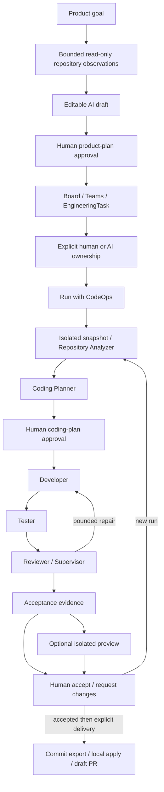

# CodeOps v1 architecture

A local modular application: React/TypeScript, FastAPI/Pydantic, SQLAlchemy and
independent LangGraph workers. SQL leases/checkpoints separate execution from
browser lifetimes. SQLite is the default; PostgreSQL shares contracts and fences.

## Identity and responsibilities

ProductGoal and draft describe proposed work; approval creates epics and CO-keyed
EngineeringTasks. Drafts never enter actionable task/capacity queries.
WorkspaceMember identities are shared; ProjectMembership/Squad organize project
ownership. Global human load, AI organizational queues and runtime reservations
are distinct. Assignment never automatically starts work.

Execution `tasks.id` identifies a coding job; WorkflowState `run_id` identifies
its snapshot/traces. Normalized links retain every task attempt, parent run and
human decision. Standalone legacy coding jobs remain compatible. Request Changes
starts a fresh source snapshot with feedback and preserves prior reviewed artifacts.

LangGraph coordinates analysis/planning and the approved development continuation.
Developer emits structured scoped edits, not arbitrary shell commands. Tester runs
bounded Docker commands or explicitly selected trusted local tests. Reviewer uses
actual diff/test evidence; Supervisor repairs within approved scope and budget.
Success enters human Review, not Done. Evidence distinguishes Verified, Supported,
Unverified and conflicts. Missing verification requires human acknowledgment.
Acceptance binds current task/run/evidence/artifact identities. Preview cannot
accept a result; delivery remains a separate action after human acceptance.

## Infrastructure and trust

* SQL: additive idempotent migrations, optimistic revisions and fenced writes;
  no destructive reset of existing tasks, assignments, executions or evidence.
* Model Gateway: shared configurable route, NVIDIA NIM/Ollama and existing
  hosted/custom protocol connections; encrypted credentials; observable fallback
  only for availability failures. Auth/validation errors remain visible. Traces
  exclude provider keys and prompts.
* Repository tools: bounded UTF-8 inspection/snapshots, excluding links, secret
  candidates, binaries and Git/build/dependency trees. Product context sends
  derived observations only; coding sees its scoped snapshot.
* Preview worker: one Python/Node Docker service; copied reviewed text in a separate
  volume, loopback HTTP health, TTL/cleanup, no source bind mounts.
* Git/GitHub: checked commit export, guarded explicit local apply, or draft PR;
  no automatic merge, deployment or acceptance.

| Package | Responsibility |
| --- | --- |
| api | HTTP validation, origin checks, enqueue/review/delivery actions |
| domain | Product/team/execution/evidence/preview contracts |
| application | Independent workers and use cases |
| workflows | Typed graph state, nodes and bounded routing |
| agents | Structured analysis/planning/development/review |
| tools | Scoped filesystem/test capabilities |
| infrastructure | SQL, model transports, Docker/workspace/Git adapters |
| core | Configuration and logging |

v1 serves one trusted local operator. Automatic dispatch, auth/RBAC,
multi-container previews and cloud deployment belong to the roadmap.
See [planning](product-planning.md), [bridge](task-execution-bridge.md),
[previews](local-previews.md), [models](provider-settings.md) and
[demo](v1-demo.md). Phase documents retain history, not current scope.
