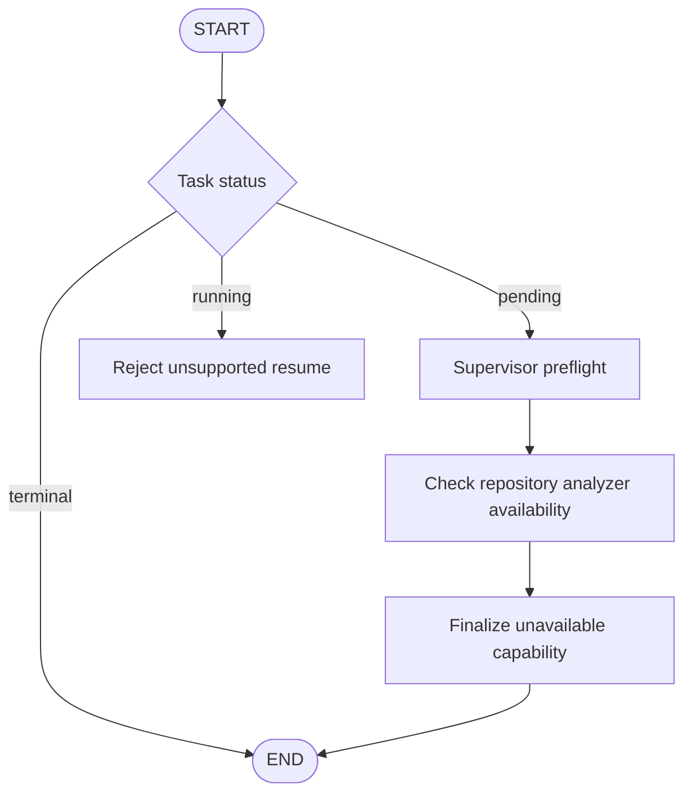

# Phase 3: basic LangGraph orchestration

This document describes the Phase 3 milestone. The current graph now performs
repository inspection and stops at the Planner boundary; see [Phase 4](phase-4.md)
for current operation names, source-directory requirements, and expected output.

## Scope and architecture

This phase adds a compiled LangGraph, deterministic supervisor orchestration,
an async runner, a CLI, and graph integration tests. It adds no Repository
Analyzer, Planner, Developer, Tester, Reviewer, or LLM-backed Report Agent.
FastAPI continues to expose only `/health`.

The first real engineering capability arrives in Phase 4. Until then, a task
must stop honestly rather than receive synthetic analysis or claim success.
The existing lifecycle has no `blocked` status, so a task needing an unavailable
capability ends as `failed`, with `AGENT_NOT_IMPLEMENTED` and a report explaining
that no engineering work occurred. The graph running correctly is distinct
from the submitted engineering task succeeding.



All three nodes perform actual orchestration operations:

1. `supervisor` starts a pending task and selects repository analysis as the next
   required capability. This is deterministic preflight, not an LLM supervisor.
2. `check_capability` finds that the Analyzer is not implemented. It records a
   nonretryable availability error. It does not invoke a fake Analyzer or inspect
   the supplied repository reference.
3. `finalize_unavailable` creates a deterministic failure summary, clears the
   active agent, and seals the task. This is a formatter, not a Report Agent.

Already-terminal snapshots pass through without new records or task mutations.
Running snapshots are rejected because resuming work requires checkpoint/worker
semantics that are not implemented. The graph has no repair loops. The runner
also uses LangGraph's recursion limit as a guard; supervisor retries remain
Phase 9.

## Files

```text
src/autonomous_engineering/workflows/
    __init__.py
    state.py       # Phase 2 state and atomic update rules
    nodes.py       # graph envelope and measured orchestration operations
    graph.py       # graph construction and conditional entry routing
    runner.py      # async validated input/output boundary
    cli.py         # local command-line invocation and JSON output
tests/
    test_workflow_graph.py
docs/
    phase-3.md
```

`domain/execution.py` gains an optional `operation` field so the three supervisor
operations are identifiable without inventing specialized-agent executions.
Older records without this field still validate. Attempts number supervisor
invocations within the run; they do not represent three development retries.

The graph has no dependencies on HTTP routes, repository tools, SQL, Redis, or
LLM provider clients. FastAPI does not instantiate it. LangGraph depends on
LangChain Core internally; this phase does not add the full LangChain package
or any provider integration.

## State integration

`GraphState` has one typed `snapshot: WorkflowState` channel, using LangGraph's
default replacement behavior. Each node:

1. Revalidates the incoming snapshot with Pydantic.
2. Produces a typed `WorkflowUpdate`.
3. Adds its execution record to that update.
4. Applies the update through `WorkflowState.apply()`.
5. Returns the complete new validated snapshot to the replacement channel.

Do not append execution history again through a graph reducer: `apply()` already
appends it. This prevents duplicated history and preserves cross-field rules
such as clearing old verification after development. An invalid update raises
before the replacement channel receives it. Terminal sealing and recording the
final operation happen in one update, avoiding mutation of a terminal snapshot.

One channel deliberately supports one writer per graph step. Parallel writes
are rejected by LangGraph rather than silently overwriting each other. That is
appropriate for the initial sequential workflow. Parallel agents would require
a deliberate channel/reducer redesign, not just adding branching edges.

No checkpointer is configured. JSON snapshot round trips and JSON-shaped graph
inputs are tested; this is not durable checkpoint/replay support. Keep database
checkpointing and its consistency contract for Phase 10.

## Execution records and errors

The returned state contains actual supervisor operation records with task/run
identity, unique execution identity, operation, invocation number, bounded
summaries, UTC start/end timestamps, status, and monotonic duration. Durations
measure the orchestration operation body up to record creation; they do not
include the subsequent validation, logging, or the entire graph invocation.
Very short operations can share wall timestamps while having positive monotonic
durations. There are no token/cost metrics or claims about engineering success.

Expected missing capability is represented in the state and leads to a failure
report. Invalid input, illegal state updates, or unexpected programming errors
raise to the caller. They are not disguised as missing capability. There is no
global exception handler, durable failure-event store, cancellation/resume
service, or production job runner yet.

`current_agent` is supervisor while these orchestration operations run. Records
and summaries are returned in memory and logged to the console; they are not
persisted. Input summaries omit the raw request and repository contents. The
CLI JSON deliberately includes the task request as part of the result.

## Install, run, and test

From the project root, update the existing virtual environment:

```powershell
.\.venv\Scripts\python.exe -m pip install -e ".[dev]"
```

This installs the declared `langgraph>=1.0,<2.0` dependency. No LLM credentials,
database, Docker, or external runtime service is required. The project does not
enable remote LangSmith tracing; externally configured tracing environment
variables can enable that dependency's tracing behavior. Graph tests explicitly
disable inherited remote tracing.

Run the orchestration example:

```powershell
.\.venv\Scripts\python.exe -m autonomous_engineering.workflows.cli --repository . --request "Inspect the repository"
```

Expected output: a JSON workflow snapshot with `task.status="failed"`, three
supervisor execution records, and error code `AGENT_NOT_IMPLEMENTED`. Analysis,
plan, tests, and review remain `null`; changes remain empty. The CLI exits with
code **2** because the engineering task could not run. This is intentional, not
an installation error or traceback. In PowerShell, inspect `$LASTEXITCODE`
immediately afterward. The repository argument is only stored in this phase;
it need not point to an existing repository for this orchestration example.

Run tests:

```powershell
.\.venv\Scripts\python.exe -m pytest -W error
```

Graph tests verify async execution, synchronous update streaming, measured record
identities, terminal bypass, rejection of running/malformed inputs, state
invalidation, rejection of false success and parallel writers, recursion limits,
independent concurrent runs, JSON round trips, and CLI output/exit status.
Synthetic success data appears only in a terminal-routing test fixture, never
in the production workflow.

The server command is unchanged:

```powershell
.\.venv\Scripts\python.exe -m uvicorn autonomous_engineering.main:create_app --factory --reload
```

## Python usage

```python
import asyncio

from autonomous_engineering.domain.tasks import TaskRecord, TaskRequest
from autonomous_engineering.workflows.runner import run_workflow
from autonomous_engineering.workflows.state import WorkflowState

initial = WorkflowState(task=TaskRecord(request=TaskRequest(
    repository_path="C:/repositories/example",
    user_request="Fix the empty-input bug",
)))
result = asyncio.run(run_workflow(initial))
print(result.report.summary)
```

Inside an existing async function, use `await run_workflow(initial)` instead.
Use `build_workflow().stream({"snapshot": initial}, stream_mode="updates")` for
local inspection of successive node outputs. The stream contains full task
snapshots and is not yet an authenticated frontend trace API.

## Phase 4

Introduce workspace-scoped read operations and a real Repository Analyzer that
returns `RepositoryAnalysis`. Connect it at the current capability boundary.
Validate path confinement, limit inspection sizes, handle unsupported manifests,
and test using real temporary repository fixtures. Do not execute repository
code while analyzing it. Later planning must remain explicitly unavailable until
Phase 5 rather than being filled with invented results.

References: [LangGraph Graph API](https://docs.langchain.com/oss/python/langgraph/graph-api),
[StateGraph and channel semantics](https://reference.langchain.com/python/langgraph/graph/state/StateGraph),
[graph execution API](https://docs.langchain.com/oss/python/langgraph/use-graph-api).
