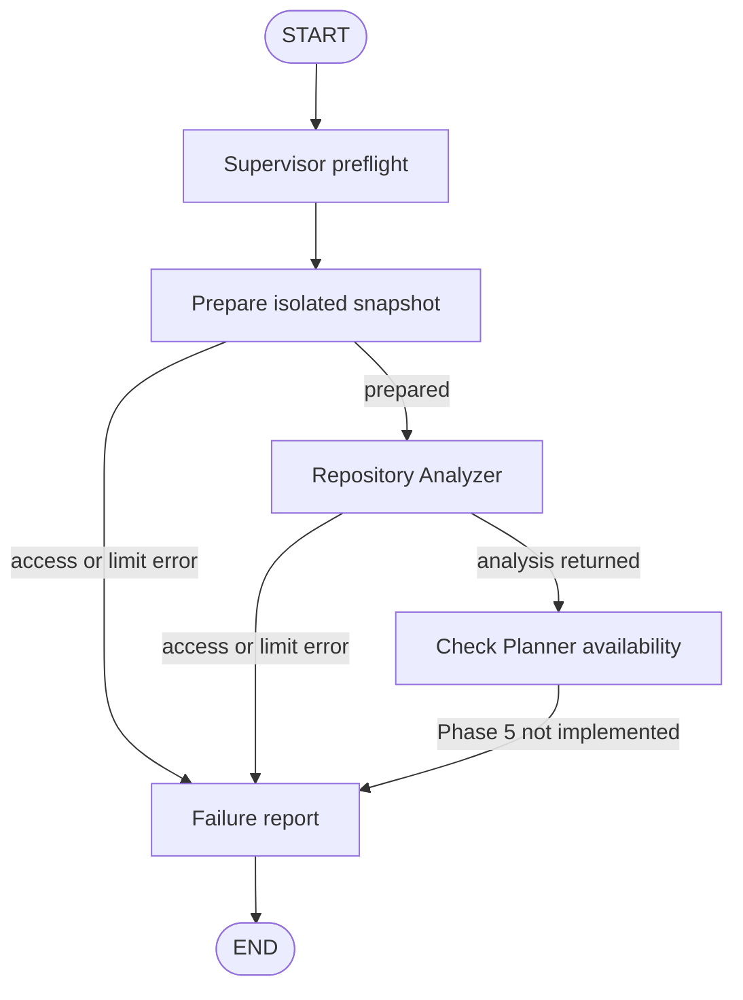

> Historical milestone: current v1 architecture and behavior are documented in
> [architecture](architecture.md), [README](../README.md) and [demo](v1-demo.md).

# Phase 4: Repository Analyzer and isolated inspection

## What this phase builds

A real, deterministic Repository Analyzer backed by bounded read tools. It
inspects an isolated text snapshot and returns structured observations about
languages, declared frameworks/dependencies, important files, repository layout,
and request-relevant file candidates. No LLM, imports of repository modules,
dependency installation, tests, builds, or shell commands are used to analyze
the repository.

Static observations provide a reproducible foundation for the later Planner.
They are not a claim that runtime architecture or the issue's root cause has
been understood. An LLM can later augment this capability using the same scoped
tools and result contract, without owning filesystem access.

## Structure and responsibilities

```text
src/autonomous_engineering/
    agents/
        __init__.py
        repository_analyzer.py   # manifest, layout, language, relevance analysis
    tools/
        __init__.py
        repository.py            # scoped inventory/read capabilities and limits
    infrastructure/
        __init__.py
        workspaces.py            # source-to-managed-snapshot preparation
    workflows/
        repository_nodes.py      # prepare/analyze adapters and error handling
        graph.py                 # success/failure routing around those operations
tests/
    test_repository.py
    test_repository_analyzer.py
    test_workflow_graph.py        # updated integration and failure-route tests
```

The Analyzer receives `RepositoryReader` plus the request, not the original
repository path. The infrastructure provisioner reads the authorized local
source to create a managed snapshot. It is the only component that assigns
`workspace_path` and `workspace_notes`; agent updates cannot override them.
This is a concrete local adapter, not a generic plugin/service framework.

Analysis contracts gain optional `inspected_file_count`,
`top_level_directories`, and `limitations` fields. Existing Phase 2 records
without these additions still validate. Counts measure inspected snapshot text
files, not every file in the original repository.

## Workflow



Terminal-entry bypass and unsupported-running-resume behavior from Phase 3
remain. A valid repository now has **five** real operation records:

1. Supervisor: initialize task.
2. Supervisor: prepare workspace.
3. Repository Analyzer: inspect snapshot.
4. Supervisor: check Planner availability.
5. Supervisor: finalize failure.

Analysis succeeds independently of the overall engineering task. The final
task still has `status="failed"` and `AGENT_NOT_IMPLEMENTED` because planning
arrives in Phase 5. The completed analysis remains available in the returned
state. Failed workspace preparation skips the Analyzer; failed analysis skips
the Planner capability check. Both routes return a structured error and report.
Unexpected programming/validation errors continue to raise to the caller.

## Workspace preparation and read boundaries

Snapshots are created under `.workspaces/<run_id>` by default. Configure
`ASE_WORKSPACE_ROOT` or inject `workspace_root` into the runner/graph for tests.
The managed storage subtree is omitted if it lies inside the source repository.
Existing run directories are never overwritten. Source repositories inside
managed storage are rejected. Caller-supplied preassigned workspaces on fresh
tasks are rejected rather than trusted.

The provisioner reads bounded eligible text before creating the destination.
Limits on entries, candidate files, depth, or total text fail explicitly rather
than returning undisclosed truncated analysis. Defaults:

| Limit | Default |
| --- | --- |
| Candidate regular files after filtering | 2,000 |
| Visited directory entries, including excluded entries | 20,000 |
| Directory depth beneath root | 32 |
| Bytes per file | 262,144 |
| Total snapshot/analyzer text bytes | 16,777,216 |

`InspectionLimits` supports explicit injection. No broad configuration surface
is added until runtime tuning needs it. Oversized individual files, binary files
containing NUL bytes, and non-UTF-8 files are skipped and counted. UTF-8 BOMs are
accepted and text is stored as UTF-8. Snapshots are filtered text copies, not
complete Git checkouts or commit-consistent snapshots.

Generated/dependency directories such as `.git`, `.venv*`, `node_modules`,
`__pycache__`, `.pytest_cache`, `build`, `dist`, and `.workspaces` are excluded.
Common credential filenames/suffixes such as `.env`, `.env.production`,
`.npmrc`, `.pypirc`, `id_rsa`, `.pem`, and `.key` are excluded. Example env
files are allowed. This is a documented filename policy, not secret detection
or evaluation of `.gitignore`. Other eligible local files, including uncommitted
and Git-ignored files, can be copied.

Reader operations reject absolute/drive/UNC paths, `..` traversal, NULs,
excluded paths, links, junctions, and non-regular files. They check every path
component and resolved root confinement. Inventory never follows links.
Managed storage cannot traverse existing link components. Windows reparse
attributes are checked so junction protection also works under Python 3.11.
No agent receives subprocess or arbitrary host-file tools.

These are prototype filesystem boundaries, not an OS sandbox against hostile
concurrent path replacement. Snapshot storage is retained for inspection and
excluded from Git; no lifecycle cleanup or durable task index is implemented
yet. A write failure can leave an incomplete snapshot directory that is never
automatically reused. Before mutation/test execution, later phases must extend
workspace lifecycle/Git semantics; Docker execution isolation remains Phase 11.

## Analysis rules

- Language detection uses known file extensions. It does not identify languages
  inside notebooks/generated assets or infer tools from filenames alone.
- Dependency parsing supports PEP 621 `pyproject.toml` dependencies and optional
  extras, basic Poetry dependency tables, simple `requirements*.txt` entries,
  and Node `package.json` dependency sections. Nested manifests are supported.
- Python requirements use `packaging.Requirement`; Node manifests use JSON;
  TOML uses the standard library. Malformed/unsupported metadata produces a
  limitation and omits dependency conclusions from that file.
- Requirements options/includes are disclosed but never followed. Dynamic
  Python dependencies are never evaluated. Full Poetry groups, requirements
  continuations/hashes, lock resolution, Cargo/Go/Java dependency parsing, and
  dependency versions are outside this initial implementation.
- Returned dependencies are normalized ecosystem-qualified names. Direct URL
  specifications, which might contain credentials, are not copied into output.
  Development, optional, and peer declarations are included. Declaration does
  not prove a dependency is installed or active at runtime.
- Framework names are inferred from recognized declared dependency names.
  Repositories using undeclared frameworks can remain undetected.
- The architecture summary reports observed languages, framework declarations,
  top-level directories, and recognized component directory names. It explicitly
  states that runtime architecture has not been verified.
- Important-file candidates are selected by names, capped at 40. Relevance uses
  request-token overlap with paths (higher weight) and the first 12,000 text
  characters per file. At most 12 candidates are returned, with important-file
  fallback when no token matches. The ordering is deterministic, not a root-cause
  diagnosis. Manifest warnings are capped at 20 distinct entries.

No raw source content or dependency URL is included in execution summaries.
Actual analysis results are stored in workflow state. Logs identify task/run,
operation, status, and measured duration. There are no invented test results or
evaluation metrics.

## Install and run

Update declared dependencies in the existing environment:

```powershell
.\.venv\Scripts\python.exe -m pip install -e ".[dev]"
```

Run against this project:

```powershell
.\.venv\Scripts\python.exe -m autonomous_engineering.workflows.cli --repository . --request "Inspect task workflow state validation"
```

The source directory must now exist. Expect a populated `analysis` object, a
managed `workspace_path`, one successful `repository_analyzer` execution, and
a final report that says the **Planner** is not implemented until Phase 5.
The CLI still returns exit code **2** for that expected unsuccessful overall
task. Empty repositories are valid: inspection reports zero files and no
invented languages. A missing source directory returns `REPOSITORY_NOT_FOUND`.

FastAPI startup is unchanged:

```powershell
.\.venv\Scripts\python.exe -m uvicorn autonomous_engineering.main:create_app --factory --reload
```

## Tests

```powershell
.\.venv\Scripts\python.exe -m pytest -W error
```

Tests use real temporary directory fixtures. They cover source/snapshot
independence, traversal and junction rejection, excluded files, size/count/depth
limits, no overwrite, nested storage exclusion, manifest variants, malformed
metadata, URL redaction, empty repositories, language/relevance observations,
and proof that an executable `setup.py` is never run. Graph tests cover valid
analysis, missing source, hard limits, failure during snapshot access, injected
storage, CLI output, and task/run isolation. Windows tests create real temporary
junctions rather than merely mocking path resolution.

## Phase 5

Add the Planner Agent using the task, observed repository analysis, and bounded
reads of relevant source files. Require a structured `ImplementationPlan` with
specific steps, risks, and test strategy. Keep planning read-only, decide the
LLM-provider/configuration boundary, and make plan approval policy explicit
before the later Developer Agent receives mutation capabilities.

References: [Python path operations](https://docs.python.org/3/library/pathlib.html),
[PEP 621 project metadata](https://packaging.python.org/en/latest/specifications/pyproject-toml/),
[dependency specifiers](https://packaging.python.org/en/latest/specifications/dependency-specifiers/),
[Node dependency declarations](https://docs.npmjs.com/cli/configuring-npm/package-json/).
