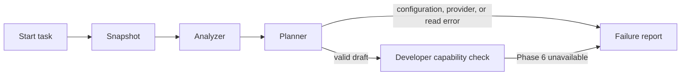

# Phase 5: read-only Planner with local Ollama

The Planner combines the task, observed repository analysis, and bounded source
excerpts into a structured draft implementation plan. It interprets the problem,
proposes ordered changes and repository-relative file paths, identifies risks,
and lists tests to run. Test suggestions are not execution evidence.

## Structure and decisions

```text
src/autonomous_engineering/
  agents/planner.py               # bounded context, provider protocol, validation
  infrastructure/ollama.py        # local structured generation and error mapping
  workflows/planner_nodes.py      # measured planning operation and state update
  core/config.py                 # local endpoint, model tag, request timeout
  domain/results.py              # plan plus reader-owned context provenance
  monitor.html                   # draft plan, evidence, risks, suggested tests
tests/test_planner.py             # reader, provider HTTP, and graph tests
```

`PlanProvider` is a narrow injection boundary justified by the external model
service and deterministic tests. The concrete adapter uses Ollama's HTTP API
through the Python standard library; an additional LangChain/SDK dependency is
unnecessary for one structured request. Domain models remain provider-independent.

The Planner has only a `RepositoryReader` for the managed snapshot. It reads at
most 12 unique relevant/important candidates, prioritizing source/test and
manifest candidates over `.md`/`.rst`/`.txt` prose while preserving relevance
order within each group. It reads at most 6,000 characters per file,
and at most 12,000 characters overall. This deliberately small first context
budget keeps local inference practical; plans must request further investigation
where that evidence is insufficient. Truncation and omitted candidates are
disclosed. Missing/inaccessible candidates fail rather than silently disappearing.
The full analysis metadata also enters the prompt. Requests above 192 KiB and
responses above 256 KiB fail explicitly. Character budgets are not token counts;
the model's context window and tokenizer can still limit usable context.

The adapter requests the Pydantic JSON schema using `format`, disables response
streaming, sets temperature to zero, and caps generation at 4,096 tokens with a
16,384-token context setting. Structured output does not guarantee a correct
diagnosis. Plans are capped at 12 steps, risks, and test checks. Incomplete,
malformed, oversized, or path-invalid plans are rejected. Reader-owned
`context_files` and `limitations` overwrite any model claims about evidence.
Exact duplicate steps are removed. A shortened file reference is resolved only
when it uniquely matches an existing snapshot path suffix; descriptions remain
model-generated. Both adjustments are disclosed. Unknown or ambiguous proposed
paths remain unchanged and are explicitly flagged for human review. This is
deterministic draft normalization, not another model call or a correctness claim.

The prompt separates instructions from repository evidence and labels source as
untrusted. This reduces injection risk but is not a guarantee against incorrect
model reasoning. The model gets no write, process, or host-file capabilities.
The original host repository path is omitted from transmitted context. Eligible
source text is still sent to local Ollama; filename exclusions are not secret
scanning. Proxies and redirects are disabled, only loopback HTTP endpoints are
accepted, and known cloud model tags are rejected. Do not alias a cloud model
under a local-looking name.

## Workflow and approval policy



Every node has real start/completion events and measured execution records.
Planning failure retains analysis but leaves `plan` absent. Provider errors
have structured codes; raw provider error bodies are not logged in summaries.
Unexpected implementation errors still raise to CLI callers and become generic
monitor stream errors with server diagnostics. There are no automatic provider
retries; `retryable` is advisory, with repair loops deferred to Phase 9.

**Every generated plan is a draft requiring human review before implementation.**
This phase grants no plan approval and implements no approval endpoint, Developer,
code writes, or tests. Phase 6 must introduce an explicit approval identity tied
to the task/run and exact plan before applying changes. Updating a plan already
invalidates downstream evidence under the existing state rules.

After a valid plan, the overall task deliberately remains failed because the
Developer is unavailable (`AGENT_NOT_IMPLEMENTED`, Phase 6). CLI exit code 2
continues to mean the overall engineering task did not succeed. The plan and
analysis remain inspectable. No model configuration produces
`PLANNER_NOT_CONFIGURED`; stopped/missing Ollama produces `OLLAMA_UNAVAILABLE`,
a missing model produces `OLLAMA_MODEL_NOT_FOUND`, timeouts produce
`OLLAMA_TIMEOUT`, and invalid model output produces `INVALID_PLAN`.

## Install and run

Install Ollama from its [official Windows download](https://ollama.com/download/windows)
and start it. Pull a local model that fits your hardware. For example, the
[Qwen2.5 Coder 3B tag](https://ollama.com/library/qwen2.5-coder:3b) is a small
coding model with a download of approximately 1.9 GB; runtime memory is additional.
Larger models may produce better plans but need more memory and time.

```powershell
ollama pull qwen2.5-coder:3b
ollama list
```

Add these settings to your local `.env` (do not overwrite other settings):

```dotenv
ASE_OLLAMA_MODEL=qwen2.5-coder:3b
ASE_OLLAMA_BASE_URL=http://127.0.0.1:11434
ASE_PLANNER_TIMEOUT_SECONDS=180
```

Restart the monitor to load settings, then open <http://127.0.0.1:8765>:

```powershell
.\.venv\Scripts\python.exe -m uvicorn autonomous_engineering.monitor:create_monitor_app --factory --host 127.0.0.1 --port 8765
```

Or run without the monitor:

```powershell
.\.venv\Scripts\python.exe -m autonomous_engineering.workflows.cli --repository . --request "Plan how to improve workflow state validation"
```

No new Python package is required. A stopped server or unsuitable model is
reported visibly rather than replaced with a canned plan. On slower hardware,
choose a smaller model or raise the timeout up to 600 seconds. The HTTP timeout
limits socket operations; it is not process isolation or a model CPU deadline.

## Test

```powershell
.\.venv\Scripts\python.exe -m pytest -W error
```

Tests need no downloaded model. They use explicit synthetic provider fixtures
and a real loopback HTTP test server to verify request schema, bounded reads,
source independence, context provenance, malformed/incomplete responses, error
redaction, graph routing, and draft-only outcomes. These fixtures are never
used by runtime code and do not measure model quality. A real Ollama run is
separate validation and requires installation plus a pulled model.

API references: [chat endpoint](https://docs.ollama.com/api/chat) and
[structured outputs](https://docs.ollama.com/capabilities/structured-outputs).
